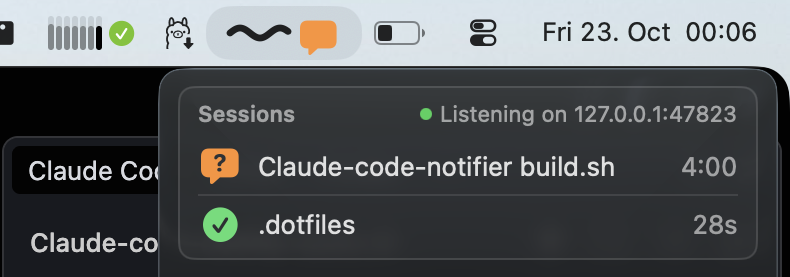

# Claude Code Notifier

A macOS menu bar app. When a Claude Code session needs you or finishes its turn, the app tells you.



## What you see

| Situation | Menu bar | Notification |
|---|---|---|
| Claude works | A green wave with a moving segment | None |
| Claude asks you (permission, question, plan approval) | An orange bubble that rings every 20 s | »Claude asks you« |
| Claude finished its turn | The wave stops | »Your turn«, with the start of the last message |
| The setup has a problem | A gap in the wave | None |

- **Menu bar icon:** always 58 pt wide. With two or more sessions, the icon shows their number, for example »×2«.
- **Card:** one row for each session, with its state, title and running time. Sessions that ask you come first.
  Archived sessions are not in the card.
- **Notifications:** one for each session. A newer one replaces the older one. A click brings VS Code to the front.
- **Sound:** only the ring of the bubble. It stops after 5 minutes without an answer. It does not play while a macOS
  Focus is on. »Play Sounds« in the menu turns it off.

## Setup

1. Move `build/Claude Code Notifier.app` to `/Applications` or `~/Applications`.
2. Open the app, and allow notifications.
3. Follow the setup window. It shows the hook block to add to `~/.claude/settings.json`, with a copy button. The app
   never changes this file.
4. Restart the open Claude Code sessions. Claude Code reads the hooks only at the start of a session.
5. Optional: select »Launch at Login« in the menu.

If the wave shows a gap later, select »Hook Setup …« in the menu. The app honors `CLAUDE_CONFIG_DIR`.

## How it works

Claude Code hooks send each event with `curl` to `http://127.0.0.1:47823/event`. If the app does not run, the hook
fails silently after at most 1 s.

| Hook | State |
|---|---|
| `SessionStart` | your turn, no notification |
| `UserPromptSubmit`, `PostToolUse` | working |
| `PreToolUse` for `AskUserQuestion\|ExitPlanMode` | asks you |
| `Notification` | asks you, one notification for each question or plan |
| `Stop`, `StopFailure` | your turn |
| `SessionEnd` | ended, no notification |

Every 3 s, the app also reads these sources:

- **Transcripts:** the marker `[Request interrupted by user]` sets the session to »your turn«. Claude Code runs no
  hook for an interrupt.
- **`~/.claude/sessions`:** the app adds sessions that started before the app, and follows a newer status.
- **VS Code database:** the app reads `hiddenSessionIds` read-only, and removes archived sessions from the card.
- **Child processes:** a session with a running background shell command counts as working.

The app accepts only requests on the loopback interface with the header `X-Claude-Hook`. It refuses requests from
web pages.

## Files on your Mac

- `~/Library/Preferences/local.claude-code-notifier.app.plist` holds the settings that differ from the default.
- macOS keeps the notification permission, the login item and an empty Metal cache folder.
- The app writes no logs and no caches.

To remove the app, delete it. Then delete the settings file with `rm`. Do not use `defaults delete`, because it
leaves an empty file.

## Build

```bash
npm run start
```

This command builds the app with `build.sh` and restarts it. The build needs only the Xcode Command Line Tools. It
runs the unit tests first. If a test fails, the build stops. The build files stay in `build/` and `.build/`. To use an SDK
other than macOS 26, set `SDK=<path>`.

## Limits

- Every user account on the Mac can reach port 47823. Another account can send fake events or, while the app does
  not run, read your hook data. On a Mac with one user, this is not a problem.
- A click on a notification brings VS Code to the front, but not always the window of the session.
- Claude Code sends the permission `Notification` only after 6 s. If you answer faster, you get no notification.
